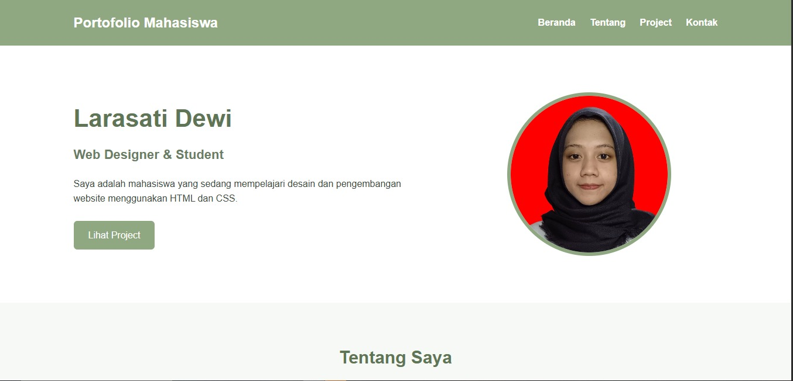
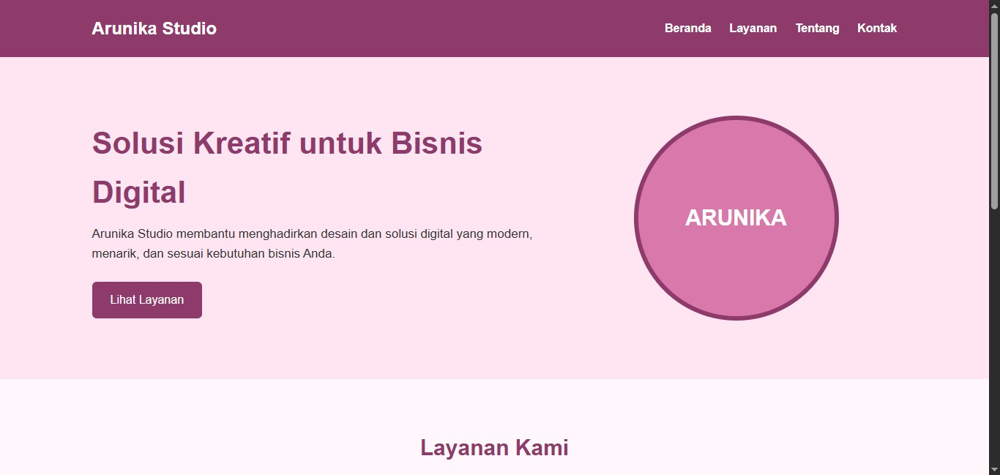

# 🌐 Web Design Projects - Arunika Studio & Portofolio Mahasiswa

Repositori ini berisi dua proyek halaman web statis yang responsif menggunakan teknologi **HTML5** dan **CSS3**. Proyek ini mencakup landing page untuk agensi kreatif bisnis digital (**Arunika Studio**) dan halaman portofolio pribadi (**Portofolio Mahasiswa - Larasati Dewi**).

---

## 🎨 Tampilan & Tema Warna

Kedua proyek ini menggunakan struktur tata letak yang bersih dan modern dengan menerapkan tema warna **Hijau Matcha (*Matcha Green*)** yang estetik dan menenangkan:
* **Matcha Green (`#8fa882`)**: Warna utama pada Header, Tombol, Border, dan Footer.
* **Deep Matcha (`#607555`)**: Warna gelap untuk teks judul agar memiliki tingkat keterbacaan yang tinggi (*high accessibility*).
* **Matcha Latte Cream (`#e3ebd8`)**: Latar belakang lembut untuk area kontras tinggi (seperti section kontak).

---

## 📂 Struktur Proyek

```text
📦 Proyek-Desain-Web
├── 📂 css
│   └── 📄 style.css              # File style global bertema Hijau Matcha
├── 📂 images
│   ├── 📷 profil.jpeg            # Foto profil Larasati Dewi
│   ├── 📷 project-1.jpeg         # Ilustrasi Project Kasir Desktop
│   ├── 📷 project-2.jpeg         # Ilustrasi Project Website Kabaroto
│   └── 📷 project-3.jpeg         # Ilustrasi Project UI/UX Figma
├── 📄 arunika.html               # Landing Page: Arunika Studio
└── 📄 biodata.html               # Landing Page: Portofolio Mahasiswa
```

## Output


*Catatan: Pastikan penataan file HTML dan aset gambar Anda sesuai dengan path `../images/` yang digunakan di dalam kode.*

---

## 🚀 Fitur & Halaman Utama

### 1. Arunika Studio (`arunika.html`)
Landing page komersial sederhana untuk studio solusi kreatif digital yang memiliki komponen:
* **Header & Navigasi**: Menu tautan cepat (*anchor links*) menuju Beranda, Layanan, Tentang, dan Kontak.
* **Hero Section**: Tagline bisnis yang dilengkapi tombol Call-to-Action (CTA) interaktif.
* **Layanan Kami**: Menggunakan tata letak kartu grid modern untuk 3 pilar layanan utama (*Web Design, UI/UX Design, Branding*).
* **Tentang & Kontak**: Penjelasan singkat agensi beserta integrasi tautan surat elektronik (*email link*).

### 2. Portofolio Mahasiswa (`biodata.html`)
Halaman portofolio pribadi akademis milik **Larasati Dewi** (Mahasiswa Web Designer) dengan komponen:
* **Hero Profil**: Memperkenalkan biodata singkat mahasiswa beserta foto profil berbingkai estetik.
* **Tentang Saya**: Deskripsi singkat mengenai minat belajar seputar HTML, CSS, dan *Responsive Web Design*.
* **Grid Project**: Galeri kartu portfolio yang interaktif (memiliki efek animasi *hover lift* ke atas) untuk menampilkan tiga proyek terbaik:
  1. Aplikasi Kasir Sederhana Berbasis Desktop (Java Netbeans & Database).
  2. Website Kabaroto (Informasi Otomotif Statis).
  3. Desain UI/UX Wedding Organizer (Prototype Figma).
* **Kontak Sosial**: Akses media komunikasi langsung melalui Email, Instagram, dan LinkedIn.

---

## 💻 Teknologi yang Digunakan

* **HTML5**: Menyediakan struktur semantik situs (seperti `<header>`, `<nav>`, `<section>`, dan `<footer>`).
* **CSS3**: Digunakan untuk pemformatan visual:
  * **Flexbox Layout**: Digunakan untuk penyelarasan elemen navigasi, hero section, dan kartu grid.
  * **Media Queries**: Mengatur *responsiveness* halaman agar tampil sempurna baik di perangkat **Tablet (max-width: 768px)** maupun **Smartphone (max-width: 480px)**.
  * **Smooth Scroll**: Efek transisi halus saat menavigasi halaman melalui menu.

---

## ⚙️ Cara Menjalankan Proyek

Karena proyek ini dibangun menggunakan teknologi berbasis *client-side* murni (statis), Anda tidak memerlukan server lokal khusus untuk menjalankannya:

1. **Unduh atau Kloning** seluruh berkas di dalam repositori ini ke komputer Anda.
2. Pastikan file CSS diletakkan di dalam folder `css/` dan aset gambar berada di dalam folder `images/` agar *pathing* tidak rusak.
3. Klik dua kali pada file `arunika.html` atau `biodata.html` untuk langsung membukanya di web browser pilihan Anda (Google Chrome, Microsoft Edge, Firefox, dll).

---

## Output


📋 *Hak Cipta &copy; 2026 FTUP & Arunika Studio. Dikembangkan untuk keperluan pembelajaran akademik.*
