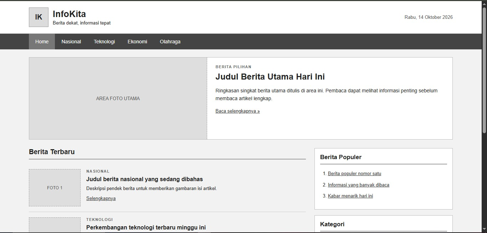

# InfoKita - Portal Berita

**InfoKita** adalah website portal berita sederhana yang dibuat menggunakan HTML dan CSS. Website ini dirancang untuk menampilkan berita utama, berita terbaru, berita populer, serta kategori berita dalam tampilan yang sederhana, rapi, dan responsif.

## Fitur Website

- **Header Website** — Menampilkan logo, nama portal berita, slogan, dan tanggal.
- **Navigasi** — Menu untuk berpindah ke halaman utama dan kategori berita.
- **Headline Berita** — Menampilkan berita pilihan beserta ringkasan dan tautan untuk membaca selengkapnya.
- **Berita Terbaru** — Menampilkan daftar berita berdasarkan kategori.
- **Berita Populer** — Menampilkan daftar berita yang populer.
- **Kategori Berita** — Menyediakan navigasi kategori Nasional, Teknologi, Ekonomi, dan Olahraga.
- **Tentang InfoKita** — Menampilkan informasi singkat mengenai website.
- **Footer** — Menampilkan nama website, deskripsi, informasi kontak, dan copyright.
- **Responsive Design** — Menyesuaikan tata letak website pada layar desktop maupun perangkat mobile.

## Teknologi yang Digunakan

- **HTML5** — Untuk membuat struktur halaman website.
- **CSS3** — Untuk mengatur tampilan, tata letak, dan responsivitas website.

## Struktur Folder

```text
InfoKita/
├── index.html
└── css/
    └── style.css
```

Keterangan:

- `index.html` — File utama yang berisi struktur dan konten halaman website.
- `css/style.css` — File stylesheet yang mengatur desain dan tata letak website.

## Cara Menjalankan Website

1. Download atau clone repository project InfoKita.
2. Pastikan struktur folder dan file sudah sesuai.
3. Buka folder project menggunakan Visual Studio Code atau editor lainnya.
4. Jalankan file `index.html` menggunakan browser seperti Google Chrome, Microsoft Edge, atau Mozilla Firefox.

Website dapat dijalankan langsung melalui browser tanpa memerlukan database maupun backend.

## Responsivitas

Website InfoKita menggunakan CSS Grid, Flexbox, dan media query untuk menyesuaikan tampilan berdasarkan ukuran layar.

Pada layar desktop, bagian headline ditampilkan secara horizontal, sedangkan daftar berita dan kolom samping ditampilkan berdampingan.

Pada layar dengan lebar maksimal 700 piksel, layout akan menyesuaikan menjadi satu kolom agar lebih nyaman digunakan pada perangkat mobile.

## Tujuan Pembuatan

Project ini dibuat untuk mempelajari penerapan HTML5 dan CSS3 dalam membangun website portal berita sederhana, termasuk penggunaan elemen semantik, navigasi berbasis anchor, pengaturan layout, serta desain responsif.

## Output


## Catatan

- Konten berita yang ditampilkan masih berupa contoh atau placeholder.
- Area foto berita belum menggunakan gambar asli.
- Tautan berita masih berupa tautan contoh.
- Website belum menggunakan database atau sistem manajemen konten.
- Tanggal pada header masih ditulis secara manual.

## Pengembang

**Nama:** [Larasati Dewi]

**Project:** InfoKita - Portal Berita Sederhana

**Tahun:** 2026
