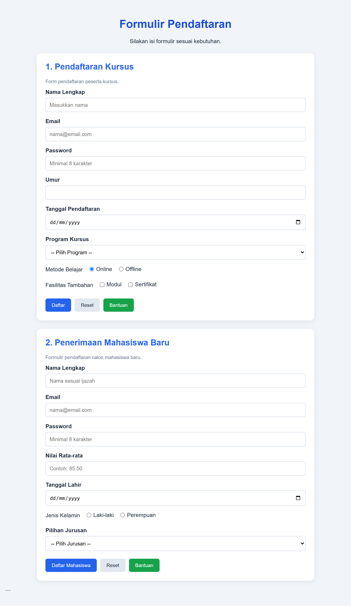

# Formulir Pendaftaran

## Deskripsi Project

Project ini merupakan aplikasi formulir pendaftaran berbasis HTML, CSS, dan JavaScript. Aplikasi ini dibuat untuk memenuhi tugas pembuatan form dengan berbagai tipe input serta penerapan atribut HTML yang benar.

Project ini terdiri dari dua formulir utama:
1. Form Pendaftaran Kursus (Individu).
2. Form Penerimaan Mahasiswa Baru (Studi Kasus).

Aplikasi ini hanya menampilkan tampilan formulir dan tidak menggunakan database maupun backend.

## Teknologi yang Digunakan

- **HTML5** — Membuat struktur halaman dan formulir.
- **CSS3** — Mengatur tampilan, warna, tata letak, dan responsivitas.
- **JavaScript** — Menangani interaksi tombol dan menampilkan pesan ketika formulir dikirim.

## Fitur

### 1. Pendaftaran Kursus
- Input nama lengkap.
- Input email.
- Input password.
- Input umur.
- Input tanggal pendaftaran.
- Pilihan program kursus.
- Pilihan metode belajar menggunakan radio button.
- Pilihan fasilitas tambahan menggunakan checkbox.
- Tombol Daftar, Reset, dan Bantuan.

### 2. Penerimaan Mahasiswa Baru
- Input nama lengkap.
- Input email.
- Input password.
- Input nilai rata-rata.
- Input tanggal lahir.
- Pilihan jenis kelamin menggunakan radio button.
- Pilihan jurusan menggunakan dropdown.
- Tombol Daftar Mahasiswa, Reset, dan Bantuan.

### 3. Fitur Tambahan
- Validasi input wajib menggunakan HTML.
- Label terhubung dengan setiap input menggunakan atribut `for` dan `id`.
- Penggunaan atribut `name` pada setiap field.
- Tampilan responsif untuk perangkat desktop maupun mobile.
- Pesan konfirmasi melalui JavaScript.
- Tombol Reset untuk mengosongkan formulir.

## Struktur Folder

```text
pendaftaran/
├── index.html
└── css/
    └── style.css
└── README.md
```

## Cara Menjalankan Project

1. Buat folder bernama `pendaftaran`.
2. Buat file `index.html` dan masukkan kode program formulir.
3. Buat file `README.md` dan masukkan dokumentasi ini.
4. Simpan kedua file di dalam folder yang sama.
5. Buka file `index.html` menggunakan browser seperti Google Chrome atau Microsoft Edge.

Project dapat dijalankan langsung tanpa menginstal server, PHP, maupun MySQL.

## Cara Menggunakan

1. Buka halaman formulir melalui browser.
2. Pilih formulir yang ingin digunakan.
3. Isi seluruh field yang wajib diisi.
4. Klik tombol Daftar untuk menampilkan pesan konfirmasi.
5. Klik tombol Reset untuk mengosongkan isian formulir.
6. Klik tombol Bantuan untuk menampilkan informasi bantuan.

## Catatan

Project ini hanya berupa tampilan frontend. Data yang dimasukkan tidak disimpan dan tidak dikirim ke server. Tombol Daftar hanya menampilkan pesan setelah validasi formulir berhasil dilakukan.

## Tujuan Pembelajaran

- Memahami penggunaan elemen form pada HTML.
- Memahami berbagai tipe input HTML.
- Menerapkan hubungan antara label dan input.
- Memahami penggunaan atribut `id`, `name`, dan `for`.
- Menerapkan CSS untuk membuat tampilan formulir yang menarik.
- Memahami interaksi dasar menggunakan JavaScript.

## Output


---

**Status Project:** Selesai — Frontend Only

**Bahasa:** HTML, CSS, JavaScript