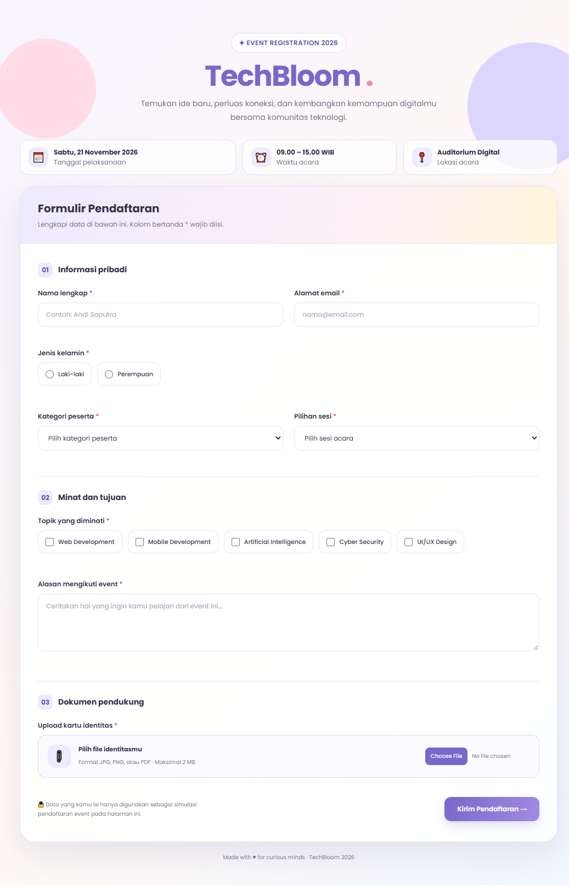

# 🌸 TechBloom 2026 – Event Registration Form

Aplikasi **Form Registrasi Event TechBloom 2026** merupakan halaman pendaftaran event seminar teknologi yang dibuat menggunakan HTML, CSS, dan JavaScript murni (Vanilla JavaScript).

Project ini dibuat sebagai tugas individu untuk menerapkan berbagai komponen form serta validasi input pada sisi Front-End.

## ✨ Fitur Utama

- **Nama Lengkap:** Input nama peserta.
- **Email:** Input alamat email peserta.
- **Radio Button:** Memilih jenis kelamin.
- **Select Option:** Memilih kategori peserta dan sesi acara.
- **Checkbox:** Memilih topik teknologi yang diminati.
- **Textarea:** Menuliskan alasan mengikuti event.
- **File Upload:** Mengunggah kartu identitas peserta.
- **Form Validation:** Memvalidasi seluruh input sebelum pendaftaran dinyatakan berhasil.
- **Responsive Design:** Tampilan menyesuaikan ukuran layar desktop dan mobile.

## 🛠️ Teknologi yang Digunakan

| Teknologi | Kegunaan |
|---|---|
| HTML5 | Membuat struktur form |
| CSS3 | Mengatur tampilan dan desain |
| JavaScript | Membuat validasi input |
| Google Fonts (Poppins) | Mengatur tipografi |

## 📁 Struktur Project

```text
Tugas Pertemuan 8/
│
├── index.html
└── css/
    └── style.css
└── README.md
```

Seluruh kode HTML, CSS, dan JavaScript digabungkan dalam satu file `index.html`.

## 📋 Aturan Validasi

Berikut aturan validasi yang diterapkan pada form:

1. Nama lengkap wajib diisi minimal 3 karakter.
2. Email wajib menggunakan format email yang valid.
3. Jenis kelamin wajib dipilih.
4. Kategori peserta wajib dipilih.
5. Sesi acara wajib dipilih.
6. Minimal satu topik minat harus dipilih.
7. Alasan mengikuti event wajib diisi minimal 10 karakter.
8. File identitas wajib diunggah dengan format JPG, PNG, atau PDF.
9. Ukuran file maksimal 2 MB.

## 🚀 Cara Menjalankan Project

1. Download atau clone repository ini.
2. Buka folder project menggunakan Visual Studio Code.
3. Buka file `index.html` menggunakan browser.
4. Isi seluruh data pada form registrasi.
5. Klik tombol **Kirim Pendaftaran**.
6. Perhatikan pesan validasi yang muncul apabila terdapat input yang tidak sesuai.

## 🧪 Pengujian Form

Pengujian dilakukan dengan mencoba beberapa skenario input yang tidak valid, seperti:

| No | Skenario Pengujian | Hasil yang Diharapkan |
|---|---|---|
| 1 | Nama dikosongkan | Muncul pesan nama wajib diisi |
| 2 | Email menggunakan format salah | Muncul pesan format email tidak valid |
| 3 | Jenis kelamin tidak dipilih | Muncul pesan wajib memilih jenis kelamin |
| 4 | Tidak memilih topik minat | Muncul pesan minimal satu topik harus dipilih |
| 5 | Alasan kurang dari 10 karakter | Muncul pesan minimal 10 karakter |
| 6 | File berukuran lebih dari 2 MB | Muncul pesan ukuran file maksimal 2 MB |
| 7 | Format file tidak sesuai | Muncul pesan format file tidak valid |

## Validasi Client-Side

Seluruh proses validasi dilakukan menggunakan JavaScript di browser (Client-Side Validation).

Validasi ini meliputi pemeriksaan:
- Input kosong.
- Format email.
- Minimal panjang karakter.
- Pilihan radio dan checkbox.
- Format serta ukuran file yang diunggah.

**Catatan:** Project ini hanya menggunakan Front-End. Data pendaftaran belum dikirim atau disimpan ke database maupun server.

## Tampilan Aplikasi

Aplikasi dirancang dengan konsep pastel modern menggunakan kombinasi warna lavender, pink, dan putih. Desain dibuat responsif sehingga dapat digunakan melalui perangkat desktop maupun mobile.

## Output



## Informasi Project

- **Nama Project:** TechBloom 2026
- **Jenis Project:** Event Registration Form
- **Kategori:** Front-End Development
- **Bahasa:** HTML, CSS, JavaScript
- **Tahun:** 2026

---

Made with ♥ using HTML, CSS, and JavaScript.
